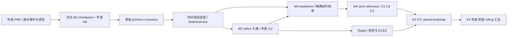

# 受影响模块、缓存、论文表图与重算成本

以下为条件性工作量，不是执行授权或已经完成的重算。当前不启动全年实验、Train拟合或云端 benchmark。

## 1. 依赖链

## 2. 按变更原因限制重算范围

| 可能批准的变更 | 受影响入口 | 可复用与需要重算 | 成本单位/目前估计 |
| --- | --- | --- | --- |
| 只修正 E3 图表符号 | `mechanisms.py`、`shared_actions.py`、export | 原曲线和动作全可用，导出反号 | O(节点×目标×动作)，M1调用0；已有小样本完成 |
| C1/C2/L_rec 统计迁移 | `shared_populations.py`、`shared_statistics.py` | 原子结果充分时只重建总体/ratio bootstrap | B=2000 的 episode 抽样；模型调用0；不足节点另列 |
| CU事件尺度按V5=1 | `annual_cu.py`、`shared_revaluation.py` | 已有native七维可重新估值；仅域均值不可逆 | O(节点×7)评分 + 全局Top-K/2000bootstrap；新状态不需要 |
| F_continuity A→B（若批准） | M2 native回调、Train尺度builder、年度adapter、新版本cache | 原始合法M1 T_IB可用；只重建F分量/其CU、scores、shortlists和受影响统计 | 2017旧canonical=5209，单表示64场景为333,376次基线映射；这是规模例，不代表旧tail可复用 |
| TURN Stage-II恢复有符号T_IB（若批准） | `validation/v2_phase5/common.py` 的新适配边界、shared state schema、M3输入 | 原始M1绝对T或PRE已观测事件可用；相关nodes的H/动作/6响应项和指标重新算 | 每节点nominal10动作；HJ/CJ≤64，HM为distinct原子数乘积；全年受影响nodes未知 |
| 旧2017 tail→合法年度tail | `annual_bridge.py`、`shared_science.py` | checkpoint权重不变；状态与依赖后果重新生成，旧score不可仅重标 | canonical用于Stage-I；C1/C2和C3所需rolling不能删减；无完整新tail年度profile，wall ETA尚不可辨识 |
| 新F Train尺度 | `data2/scripts/build_year_references.py`、`annual_cu.py` | 其余六项reference不重拟合；新F需合法Train统计及新hash | Train rows流式/分块统计；正值支持未知，不填常数；不覆盖旧2017公共reference |
| E4重汇总 | `e4_shared_aggregate.py` | 读取新版本年度E1–E3，不重跑PRE/M1/M2 | O(年度原子记录 + 2000 cluster统计)；等待充分合法年度输出 |

## 3. 现有缓存的实际可逆性

- `annual_2017_bounded_v2_20261012/E1/chunks`：32个旧评分chunk，含D、C、域分数/支持/身份/曝光；**没有完整七维native或绝对T**。不能从域均值无损恢复新F、新CU或年度tail场景。
- 其 `SHARED_V1/SHARED_ANNUAL_NODES.jsonl`：5,209 canonical的旧HJ紧凑视图，manifest明确CJ/HP/HM/Stage-II仍缺；不是当前 `shared/CACHE_MANIFEST.json` 格式，也不能把它当完整状态缓存。
- 新 `shared/stage1`：含representation分数、component scores、部分native expected、支持、canonical flag；保持原身份时可用于尺度/统计重估，但其T仍为压缩后的R_IB。
- 新 `shared/states`：每node保存HJ/CJ/HP状态和binding，HM可精确重建；TURN过去T必须额外从合法原始源恢复。
- `actions/*.native.jsonl.gz`：当前是每representation/机制/动作的**加权七维汇总**，不是全部逐场景原始状态。适合已算动作的线性重新加权；无法反推缺失的T或更改非线性headroom。
- `actions/*.json`、E2_E3摘要：可用于统计重估、e符号导出；不能通过改hash把旧科学身份强行提升。

## 4. 论文受影响位置

| 最新稿件锚点 | 受影响输出 | 何时需更新 |
| --- | --- | --- |
| S4 `tab:consequence_native_sec4`；Sup `tab:sup_consequences` | F公式/原点、proxy解释、年度F尺度 | 科研裁决后 |
| S5 `tab:annual_evaluation_support`；Sup `tab:sup_sixyear_support` | canonical/Stage-II/C2/rolling/support分母 | 支持/输入身份变化时 |
| S5 `fig:q_boundary` | 四筛查视角、Top-K、attention、paired增量CI | consequence/scale/tail变更时 |
| S5 `fig:stage2_recoverability` | V、Coverage@K、shortlist/full-eligible关系 | shortlist或动作/支持变化时 |
| S5 `tab:information_decision_summary` | activation、agreement、absolute regret、L_rec及CI | 对照总体、状态或headroom变更时 |
| S5 `fig:objective_dependence` | 四目标、e(u)、margin、decision sensitivity、regret | 输出符号可直接迁移；状态/动作变更需重评 |
| S5 `fig:threshold_headroom` | 四机制结构、Joint reference、component response | 算子不变时复用充分曲线；坐标变更时核验 |
| S5 §5.6 / Sup E4 | 年度、两轨CU、PRE/TURN、rolling trajectories | 年度输入与结果合法完整后重新聚合 |

## 5. 时间估计的证据边界

已有 current-tail 真实小样本对账为2episode/5canonical、192.17秒；另一个旧tail单节点policy对账约3.38秒，Exact carrier=806。二者包含不同工作/缓存命中/状态身份，**不能线性外推六年正式墙钟时间**。当前tail pilot HM最大6,720，理论64原子三维乘积可达262,144；流式只控制内存，不消除组合计算量。

本轮文档与已有小样本验收可在本地交付。后续纯统计/导出重估工作可优先做，不需重训。完整六年ETA须在科学裁决、21项年度输入缺口解除及获准benchmark之后，以C1/C3节点数、carrier分布、每节点耗时估计；目前为 `NOT_ESTIMABLE_WITH_VALID_ANNUAL_PROFILE`，不承诺虚假的小时数。

六年准备仍有：科学裁决（F与TURN坐标）、P1剩余输出接口、年度模型/tail缺口、Linux/CUDA实测、独立验收。C07 receipt暂不实施；不得用其hash改写绕开上述依赖。
